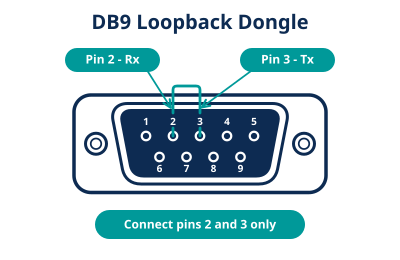

[:gb: English](README.md) · **:fr: Français**

# Identificateur de ports série
Programme permettant de répertorier facilement tous les ports série installés sur un ordinateur et de les identifier physiquement.

## Utilisation

* Fabriquez un dongle de bouclage avec un connecteur DB9 standard et reliez uniquement les broches 2 (Rx) et 3 (Tx).

* Branchez successivement votre dongle sur tous les ports (ports intégrés ou adaptateurs USB-série).
* La LED du port auquel le dongle est branché devient 🟢 **Connecté**.
* Enjoy :wink:

États des ports :

* 🟢 **Connecté** : le dongle de bouclage est détecté.
* 🔴 **Non détecté** : le port est libre, mais aucun écho n’est reçu.
* 🟠 **Indisponible** : le port ne peut pas être ouvert, généralement parce qu’une autre application l’utilise.

> [!TIP]
> Débranchez tous les connecteurs des ports série du PC avant de lancer le programme.

> [!WARNING]
> Le programme ouvre périodiquement chaque port série et y écrit quelques octets aléatoires.
> Les signaux DTR et RTS restent à l’état bas afin d’éviter de réinitialiser des cartes comme les Arduino, mais évitez d’exécuter le programme lorsqu’un équipement réel (modem, automate programmable, etc.) est connecté.

## Création d’un exécutable autonome pour éviter d’avoir à installer Python sur l’ordinateur cible

### Créer un environnement virtuel

Linux :

```shell
me@mypc:~/workspace/SerialPortIdentifier$ python3 -m venv .venv
me@mypc:~/workspace/SerialPortIdentifier$ source .venv/bin/activate
(.venv) me@mypc:~/workspace/SerialPortIdentifier$ pip install -r requirements-build.txt
```

Windows (PowerShell) :

```powershell
PS C:\workspace\SerialPortIdentifier> python -m venv .venv
PS C:\workspace\SerialPortIdentifier> .\.venv\Scripts\Activate.ps1
(.venv) PS C:\workspace\SerialPortIdentifier> pip install -r requirements-build.txt
```

### Générer l’exécutable

```shell
(.venv) me@mypc:~/workspace/SerialPortIdentifier$ python build.py
```

L’exécutable est généré dans le répertoire `dist/`.
